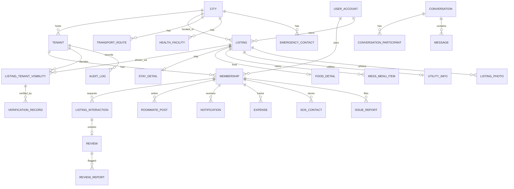

# Basera architecture

## Shape
Modular monolith (one Spring Boot service) + React SPA + PostgreSQL 16 with PostGIS. One tenant = one college. Tenants are
resolved from the **host** (`<slug>.basera.app`); the API lives under each college host (`/api/v1/...`), so cookies are
host-only and no CORS is needed. `auth.<domain>` hosts only the Google login redirect (Google does not allow wildcard redirect
URIs), `admin.<domain>` hosts the SUPER_ADMIN console.

## Multi-tenancy: shared schema + Row Level Security
* Three database roles: `basera_owner` (migrations only), `basera_app` (every tenant request; subject to RLS, never bypasses it),
  `basera_platform` (BYPASSRLS but limited by table grants; reachable only from the `platform`, `auth` and `tenancy` packages,
  enforced by an ArchUnit test).
* At the start of **every** transaction a custom `JpaTransactionManager` runs `set_config('app.current_tenant', …, true)`
  (also `app.current_user`, `app.current_role`). `true` = transaction-local, so a pooled connection can never carry one request's
  tenant into the next. No tenant context means NULL, which means no rows (fail closed).
* Tenant-owned tables carry `tenant_id` and composite foreign keys, so a row can never reference another tenant's data, not even
  through the BYPASSRLS role.
* Listings belong to an **owner**, and are shown to colleges through `listing_tenant_visibility` (approval, verification and
  ratings are per college). Distance from each campus is computed at query time with PostGIS.
* City-level content (transport, clinics, emergency numbers, area notes, KYC guides) is stored once per city and is read-only for
  tenant code.
* Isolation is **tested**: `RlsIsolationIT` (database level, as the real runtime role), `TenantApiIT` / `MarketplaceFlowIT`
  (full stack), and meta-tests that fail the build if any table with `tenant_id` lacks forced RLS and a policy.

## What RLS does and does not guarantee
RLS guarantees the **tenant boundary** and listing ownership. It does not know about roles: whether a student may see a PENDING
listing, or who may confirm a stay, is enforced in the service layer (and covered by integration tests).

## Auth
Google OpenID Connect authorization-code flow, done statelessly (signed `state` JWT + a nonce cookie bound to the browser).
One-time code handed to the college host, exchanged for a 15-minute access JWT (kept in memory only) and a rotating,
hashed, host-only HttpOnly refresh cookie. Reuse of an old refresh token revokes the whole token family.
JWTs are bound to one tenant (`tid`) and rejected on any other college's host.

## "Verified" is a defined process
A college admin completes a four-point checklist (identity, ownership papers, site visit, written terms). The badge expires
(default 12 months) and stops counting the moment the address, location, rent or deposit changes. It reduces risk; it is not
a guarantee, and the UI says so.

## Modules (each toggleable per college)
Stay, Food, Utilities, Reviews, Roommates, Budget, Guide, Safety, Notifications, Scam protection. Emergency numbers stay
available even if Guide is switched off.

## Realtime and background work
No broker. Chat uses polling (works across replicas). Email is a Postgres outbox drained by a scheduled dispatcher using
`FOR UPDATE SKIP LOCKED`; recipients' addresses are resolved at send time on the platform pool.

## Database diagram (key tables)

